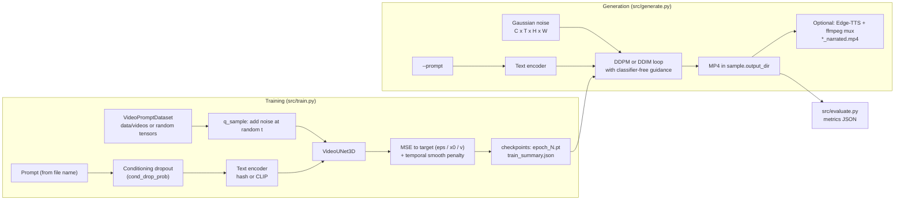

# Text-to-Video Diffusion

A compact, from-scratch text-to-video diffusion framework in PyTorch. It trains a small 3D U-Net denoiser directly in pixel space on short clips (8 frames at 32x32 by default), samples new clips from a text prompt with DDPM or DDIM and classifier-free guidance, evaluates them with frame- and video-level metrics, and can optionally add synthesized narration (Edge-TTS) to the resulting MP4.

The project is research and coursework oriented: it is built to make the diffusion mathematics, the architecture and the ablations easy to inspect, not to produce high-quality video.

## Problem statement

Generating short clips from text adds two requirements to image diffusion: frames must stay consistent over time (temporal coherence), and the content must follow the prompt (text-video alignment). This repository implements a minimal pipeline in which both aspects can be varied and measured: temporal self-attention plus an optional temporal smoothness penalty for coherence, and two interchangeable text encoders plus classifier-free guidance for alignment.

## Key features

- **3D U-Net denoiser** (`src/models/video_diffusion.py`): 3D-convolution residual blocks with timestep conditioning, one strided down/up-sampling stage over time and space, a skip connection, and a temporal self-attention block at the bottleneck (attention over the frame axis, computed independently at each spatial location).
- **Text conditioning by embedding addition**: the text vector is projected by a small MLP and added to the timestep embedding, which is then injected into every residual block. There is no cross-attention between text and video features.
- **Two text encoders** (selected by `model.text_encoder`):
  - `hash` (`src/text.py`): hashed bag-of-words vector (MD5 token hashing, L2-normalised), no external model.
  - `clip` (`src/text_clip.py`): OpenCLIP ViT-B-32 (`laion2b_s34b_b79k`) text features, 512-dimensional.
- **Diffusion process** (`src/diffusion.py`): linear or cosine beta schedules; `eps`, `x0` or `v` prediction targets; DDPM and deterministic DDIM sampling steps; classifier-free guidance (conditioning dropout during training, guided combination at sampling time).
- **Temporal smoothness regulariser**: optional penalty on frame-to-frame differences of the model output (`train.temporal_smooth_weight`).
- **Evaluation** (`src/evaluate.py`, `src/metrics_video.py`): SSIM, PSNR, a temporal frame-difference proxy, an FVD *proxy* (Fréchet distance on per-frame Inception-v3 features, not I3D-based FVD), Inception Score, temporal LPIPS, CLIP similarity and an optical-flow (RAFT) warping error. Optional metrics are skipped if their dependency is unavailable.
- **Ablation tooling**: `src/ablate_targets.py` trains one run per prediction target and writes a JSON/CSV summary of final training losses; `src/plot_ablation.py` plots it; `scripts/collect_phase1_metrics.py` trains, samples and evaluates the three Phase-1 configurations.
- **Narration (optional)** (`src/audio/`): Edge-TTS speech synthesis with voice selection, emotion presets mapped to rate/pitch/volume, sentence-aware chunking, and ffmpeg muxing into the MP4 (the ffmpeg binary is provided by `imageio-ffmpeg`).

## Tech stack

| Area | Libraries |
|---|---|
| Model and training | PyTorch, torchvision, NumPy |
| Configuration | PyYAML |
| Video I/O | imageio, imageio-ffmpeg, Pillow |
| Text encoding | hashlib (standard library), open-clip-torch |
| Metrics | scikit-image, SciPy, torchmetrics, lpips, torchvision (Inception-v3, RAFT) |
| Plotting | matplotlib |
| Narration | edge-tts, ffmpeg (via imageio-ffmpeg) |

## Architecture



Inside `VideoUNet3D`: input 3D conv, two residual blocks, a stride-2 3D conv (halves frames, height and width), a bottleneck residual block followed by temporal self-attention, a transposed 3D conv back to full resolution, concatenation with the first-level features, one residual block and an output conv.

## Project structure

```text
text-to-video-diffusion/
├── configs/
│   ├── base.yaml               # default training/sampling/audio settings
│   ├── phase1_baseline.yaml    # hash text, no temporal smoothing
│   ├── phase1_smooth.yaml      # hash text + temporal smoothing (0.02)
│   └── phase1_clip.yaml        # CLIP text + temporal smoothing (0.02)
├── data/
│   └── reference/
│       └── a_rainy_neon_street_in_a.mp4   # small reference clip used by the Phase-1 metrics script
├── paper/
│   └── phase1.tex              # Phase-1 report draft (LaTeX)
├── scripts/
│   └── collect_phase1_metrics.py
├── src/
│   ├── train.py
│   ├── generate.py
│   ├── evaluate.py
│   ├── metrics_video.py
│   ├── diffusion.py
│   ├── text.py                 # hashed bag-of-words encoder
│   ├── text_clip.py            # OpenCLIP encoder + encoder selection
│   ├── ablate_targets.py
│   ├── plot_ablation.py
│   ├── add_narration.py
│   ├── utils.py
│   ├── audio/                  # edge_tts_pipeline.py, mux.py
│   ├── data/                   # video_dataset.py, prompts.py
│   └── models/                 # video_diffusion.py
├── paper_template.md
├── SUBMISSION_CHECKLIST.md
└── requirements.txt
```

`outputs/`, `checkpoints/` and `logs/` are git-ignored and are created when the scripts run.

## Getting started

### Prerequisites

- Python 3.9 or newer
- Optional: a CUDA GPU. The scripts use CUDA when available and otherwise run on CPU; the default configuration is sized for CPU.
- Internet access the first time CLIP, Inception-v3, LPIPS or RAFT weights are downloaded, and for Edge-TTS synthesis (an online service).

### Installation

```bash
git clone https://github.com/Rewanooo22/text-to-video-diffusion.git
cd text-to-video-diffusion
python -m venv .venv
source .venv/bin/activate        # Windows: .venv\Scripts\activate
pip install -r requirements.txt
```

All commands below are run from the repository root.

### Training data

`src/data/video_dataset.py` recursively loads `.mp4`, `.gif`, `.avi`, `.mov` and `.mkv` files from `data.dataset_root` (default `data/videos`). Each clip is sampled to `num_frames` evenly spaced frames, resized to `frame_size`, and paired with a prompt derived from its file name (underscores become spaces).

**No training dataset is included in this repository.** If `data/videos` is missing or empty, the dataset falls back to uniformly random tensors paired with the built-in prompts from `src/data/prompts.py`. `train.py` prints a warning in that case, and a model trained this way will not produce meaningful videos. Each epoch draws at least 128 samples, cycling through the available videos if there are fewer.

### Train

```bash
python -m src.train --config configs/base.yaml
```

`--config` is the only flag. Checkpoints are written to `train.checkpoint_dir` as `epoch_<N>.pt`, together with `train_summary.json` (per-epoch mean losses).

### Generate

```bash
python -m src.generate --config configs/base.yaml \
  --checkpoint checkpoints/epoch_5.pt \
  --prompt "A rainy neon street in a futuristic city, camera slowly dollying forward" \
  --seed 42
```

| Flag | Description |
|---|---|
| `--config` (required) | YAML configuration |
| `--prompt` (required) | Text prompt |
| `--checkpoint` | Path to a `.pt` checkpoint; if omitted, the model is randomly initialised |
| `--seed` | Fix RNGs before sampling when `>= 0` (default `-1`) |
| `--narration` | Narration text to synthesise and mux into the video |
| `--voice` | Edge voice short name, e.g. `en-US-GuyNeural` |
| `--emotion` | `neutral`, `happy`, `excited`, `sad` or `calm` |
| `--skip_audio` | Disable audio even if the config enables it |

The clip is saved to `sample.output_dir` as an 8 fps MP4 named after the first six words of the prompt. Sampler, number of steps and guidance scale come from the `sample:` section of the config.

### Evaluate

```bash
python -m src.evaluate --pred_dir outputs/generated --gt_dir data/reference \
  --text_prompt "A rainy neon street in a futuristic city, camera slowly dollying forward" \
  --output_json outputs/eval_report.json
```

Predicted and reference videos are paired by identical file name. Flags: `--pred_dir` and `--gt_dir` (required), `--text_prompt` (used for CLIP similarity; defaults to the prediction file name), `--device` (`cuda` or `cpu`; default `cuda`, falling back to CPU), `--output_json`.

### Ablations

```bash
# One training run per prediction target; summary written to outputs/ablation/
python -m src.ablate_targets --config configs/base.yaml --targets eps x0 v
python -m src.plot_ablation --csv outputs/ablation/target_ablation_summary.csv

# Phase 1: train, generate (seed 42) and evaluate the three phase1_*.yaml configs
python scripts/collect_phase1_metrics.py
```

`ablate_targets` compares final training MSE only (`--output_dir` changes the summary location). `collect_phase1_metrics.py` writes per-run metric JSON files and `outputs/phase1/table_summary.json`; if the reference clip is missing, it first writes a synthetic sinusoidal-pattern clip to `data/reference/`.

### Add narration to an existing clip

```bash
python -m src.add_narration --video outputs/generated/<clip>.mp4 \
  --text "In the distance, hover-trains slice through the rain." \
  --config configs/base.yaml --voice en-US-GuyNeural --emotion calm
```

`--text_file` can be used instead of `--text`; `--rate`, `--pitch`, `--volume`, `--chunk_chars` and `--out` are also available. Narration defaults can be set under `audio:` in the config. List available voices with `edge-tts --list-voices`.

## Configuration

Main settings in `configs/*.yaml` (defaults from `configs/base.yaml`):

| Section | Keys |
|---|---|
| `data` | `dataset_root`, `channels`, `num_frames` (8), `frame_size` (32), `batch_size` (1) |
| `model` | `base_channels` (32), `time_emb_dim` (128), `text_encoder` (`hash` / `clip`), `text_emb_dim` (128 for hash, 512 for CLIP) |
| `diffusion` | `timesteps` (1000), `beta_schedule` (`linear` / `cosine`), `prediction_target` (`eps` / `x0` / `v`) |
| `train` | `lr`, `epochs` (5), `grad_clip`, `cond_drop_prob` (0.1), `temporal_smooth_weight` (0.02), `save_every`, `checkpoint_dir` |
| `sample` | `sampler` (`ddpm` / `ddim`), `num_steps` (50), `guidance_scale` (5.0), `output_dir` |
| `audio` | `enable`, `narration_from_prompt`, `voice`, `emotion`, `chunk_chars`, `rate`, `pitch`, `volume` |

When switching to `text_encoder: clip`, set `text_emb_dim: 512` (as in `configs/phase1_clip.yaml`).

## Results

No trained checkpoints, generated videos or metric reports are committed, and the results table in `paper/phase1.tex` is an unfilled placeholder. To obtain numbers, train on a real video dataset and run the evaluation or Phase-1 scripts above.

## Project status and limitations

- Coursework-scale prototype: one down/up-sampling level, one attention block, and 32x32, 8-frame clips by default.
- Text conditioning is additive (no cross-attention), which limits prompt alignment.
- The `channel_mults` key in the configs is not read by the model.
- Without videos in `data/videos`, training runs on random noise.
- The FVD metric is a frame-level Inception proxy, not standard I3D-based FVD; the target ablation compares training loss only.
- The Phase-1 script's default reference clip is a synthetic pattern, so metrics against it only check that the pipeline runs.

## Future improvements (ideas)

- Cross-attention from text tokens to spatio-temporal features.
- A deeper multi-resolution U-Net driven by `channel_mults`, plus spatial attention.
- Latent-space diffusion with a pretrained VAE for larger resolutions.
- I3D-based FVD and evaluation on a real reference set.
